## 📖 Chapter I · Mage License

> Every contribution is 1 XP. Rank and level are recalculated from my real GitHub history every morning.
> **Apprentice Mage → Junior Magic Knight → Magic Knight → Senior Magic Knight → Vice Captain → Squad Captain → Archmage → Grand Archmage**

## ⚡ Chapter II · Magic Affinity

**Learned spells**

## 🔮 Chapter III · Mana Flow

🐍 The grimoire's familiar feeds on spent mana.

## 👹 Chapter IV · Boss Raid

> Every contribution this year deals 1 damage to the Legacy Code Behemoth. It has 1,000 HP, and it respawns stronger every time it falls.

## 📜 Chapter V · Quest Board

<table>
<tr>
<td width="50%" valign="top">

### 🗡️ [Pro-Desk](https://github.com/abhi-jithb/Productive-Desk)
`RANK S` · `CLEARED`

A focus app for Linux (Fedora/GNOME). It casts a binding spell on distractions.

**Loot:** `Electron` `TypeScript` `Go` `SQLite` `DBus` 

</td>
<td width="50%" valign="top">

### 📚 [Story Weaver](https://github.com/abhi-jithb/storyweaver-frontend)
`RANK A` · `CLEARED`

A React front-end for StoryWeaver by Pratham Books, a library of multilingual children's stories.

**Loot:** `React` `Node.js` 

</td>
</tr>
<tr>
<td width="50%" valign="top">

### 🛒 [College Vyapari](https://github.com/abhi-jithb/college-Vyapari)
`RANK A` · `CLEARED`

A campus guild hall: students take on paid tasks and earn gold.

**Loot:** `React` `Tailwind` `Node.js` `MongoDB` 

</td>
<td width="50%" valign="top">

### 💡 [Idea Thattukada](https://github.com/abhi-jithb/Idea-Thattukada)
`RANK B` · `ALWAYS OPEN`

An enchanted notebook that traps ideas before they escape on a Monday.

**Loot:** `HTML` `JavaScript` `JSON` 

</td>
</tr>
</table>

## 🎮 Chapter VI · Side Quests

👾 A wild Pac-Man has entered the mana field.

 

<b>🏰 Dungeon Run: enter the Production Dungeon</b> (click to start)

 

> *You stand before the Production Dungeon. It's Friday, 5:47 PM. A deploy button glows in the dark.*

🚪 <b>Door A:</b> Press deploy right now

 

> The ground shakes. A Null Pointer Wraith rises from the logs.

⚔️ Fight it with <code>console.log</code>

 

> You scatter 47 logs across the codebase. The Wraith vanishes, and nobody knows why.
> **🏆 Achievement unlocked: It Works On My Machine.** *+50 XP, −100 sanity*

🏃 Roll back and run

 

> A wise retreat. You live to deploy on Monday.
> **🏆 Achievement unlocked: Senior Engineer Energy.** *+200 XP*

🚪 <b>Door B:</b> Write tests first

 

> Tests pass. Tests pass on CI. The deploy goes out cleanly.
> You leave the dungeon untouched by fire. Confused, the boss writes you a LinkedIn recommendation.
> **🏆 Legendary ending: The Green Pipeline.** *+1000 XP*

🚪 <b>Door C:</b> Ask in the team chat "anyone deploying?"

 

> Silence. Three people react with 👀. You wait until Monday.
> **🏆 Achievement unlocked: Diplomat.** *+10 XP*

<b>🧩 Grimoire Riddle</b>: can you solve it?

 

> *I have keys but open no doors. I have space but hold no room. You can enter, but never leave.*

Reveal the answer

 

**A keyboard.** ⌨️ Unless you're in Vim. Then you truly cannot leave. `:q!`

<b>🎲 Character Sheet</b>: honest stats

 

| Attribute | Value | Notes |
|---|:-:|---|
| ⚔️ STR (shipping) | 17 | Can push to main with one hand |
| 🧠 INT (debugging) | 15 | +5 after 2 AM, −5 after 4 AM |
| 🗣️ CHA (code review) | 12 | "nit:" is my love language |
| 🍀 LUCK | 3 | Tests pass locally, fail on CI |
| ☕ CONSTITUTION | 20 | Powered by chaya |

## 🗞️ Chronicles

- 📖 [Open Source: Overcoming Imposter Fear](https://overcoming-opensource-imposter-fear.hashnode.dev/open-source-overcoming-imposter-fear)
- 📖 [How to Start Contributing to Open Source](https://abhijithb1.substack.com/p/how-to-start-contributing-to-open?r=3h1zgm)
- ➡️ More scrolls on [Hashnode](https://hashnode.com/@abhijithb)

## 💰 Guild Treasury

**My magic? I don't close the tab until the build is green.** 🔥

